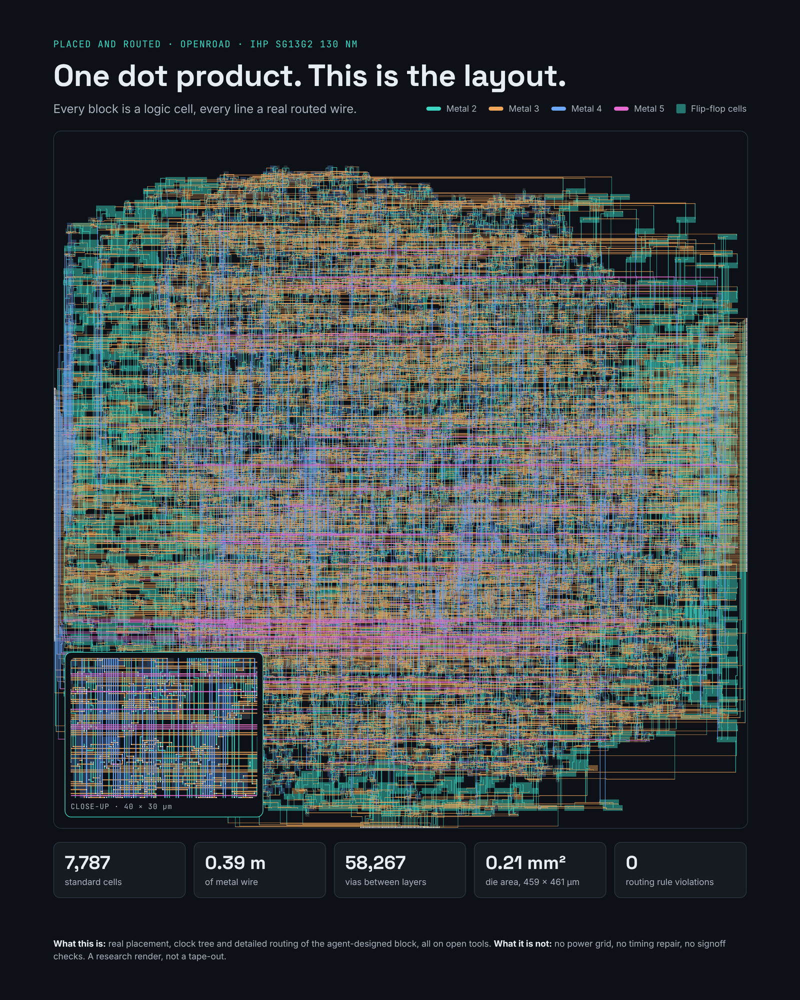

# chip-harness: agent-in-the-loop RTL for a video-generation kernel, on an open chip flow



Built 16 Nov 2026 in one session. An agent (Claude, in this session) proposes RTL for a small accelerator block;
a validator harness decides whether each proposal is correct and how good it is. Everything runs on open tools
and an open European process kit.

- **Block:** `dot_s8`, a 27-tap signed 8-bit dot product: one 3x3x3 window of a causal 3D convolution, the inner
  loop of a video VAE decoder. Spec in `spec/task.md`.
- **Flow:** Verilator lint -> Icarus RTL simulation against a Python golden model -> Yosys SAT equivalence ->
  Yosys/ABC synthesis to IHP SG13G2 cells -> Verilator gate-level simulation -> OpenSTA timing and power.
- **Result:** see the table. Read the limits section before quoting any number.

## Results

### Yosys 0.71 (current release; Booth multiplier mapping enabled for the baselines)

| Design | Verdict | Cells | Area (um2) | Min period (ns) | Fmax (MHz) | Power @100 MHz (mW) | Energy/op (pJ) |
|---|---|---|---|---|---|---|---|
| b0_behavioral_yosys071_booth | PASS | 9722 | 121175 | 6.28 | 159 | 6.51 | 65.1 |
| b1_hand_tree_yosys071_booth | PASS | 9722 | 121175 | 6.28 | 159 | 6.51 | 65.1 |
| c1_bw_dadda_yosys071 | PASS | 9781 | 121631 | 5.19 | 193 | 6.73 | 67.3 |
| c2_booth_dadda_yosys071 | PASS | 8978 | 112740 | 5.38 | 186 | 6.10 | 61.0 |
| c3_booth_preenc_yosys071 | PASS | 7707 | 109475 | 5.30 | 189 | 6.71 | 67.1 |
| c4_booth_preenc_prefix_yosys071 | PASS | 7686 | 109379 | 5.07 | 197 | 6.71 | 67.1 |

Relative to the strongest baseline here, `b0_behavioral_yosys071_booth`:

- c1_bw_dadda_yosys071: +0% area, -17% delay, +3% power
- c2_booth_dadda_yosys071: -7% area, -14% delay, -6% power
- c3_booth_preenc_yosys071: -10% area, -16% delay, +3% power
- c4_booth_preenc_prefix_yosys071: -10% area, -19% delay, +3% power

### Yosys 0.33 (Ubuntu 24.04 package; no Booth option)

| Design | Verdict | Cells | Area (um2) | Min period (ns) | Fmax (MHz) | Power @100 MHz (mW) | Energy/op (pJ) |
|---|---|---|---|---|---|---|---|
| b0_behavioral | PASS | 13895 | 165710 | 6.60 | 152 | 8.04 | 80.4 |
| b1_hand_tree | PASS | 13900 | 165790 | 6.57 | 152 | 8.09 | 80.9 |
| c1_bw_dadda | PASS | 9691 | 120995 | 5.24 | 191 | 6.71 | 67.1 |
| c2_booth_dadda | PASS | 8480 | 110561 | 5.53 | 181 | 6.07 | 60.7 |
| c3_booth_preenc | PASS | 7754 | 109191 | 5.21 | 192 | 6.69 | 66.9 |
| c4_booth_preenc_prefix | PASS | 7755 | 109205 | 5.12 | 195 | 6.69 | 66.9 |

Relative to the strongest baseline here, `b0_behavioral`:

- c1_bw_dadda: -27% area, -21% delay, -17% power
- c2_booth_dadda: -33% area, -16% delay, -25% power
- c3_booth_preenc: -34% area, -21% delay, -17% power
- c4_booth_preenc_prefix: -34% area, -22% delay, -17% power

### Negative controls (deliberately broken designs)

| Design | Verdict | RTL sim mismatches | Formal N=1 |
|---|---|---|---|
| x1_rare_value_bug | REJECTED@formal | 0 of 5330 | counterexample found |
| x2_swapped_taps | REJECTED@rtl_sim | 5116 of 5330 | not reached |

How to read it:

- The honest headline is the Yosys 0.71 section, where the baseline gets the tool's own Booth multiplier mapping.
  The larger gap in the Yosys 0.33 section is mostly an old tool sign-extending every product to 21 bits.
- `b0` (behavioural loop) and `b1` (hand-structured multipliers plus adder tree) come out of Yosys as the same
  circuit to within five cells, because the tool merges the arithmetic either way.
- `c2` has the lowest power; `c3`/`c4` are faster but burn more power because their 108 extra flops are clocked
  every cycle.

## What is verified

- Every scored design passed: lint; 5,330 RTL vectors (corner cases, one-hot per tap, uniform random, conv-like);
  SAT equivalence against the reference at one tap (a full proof of the per-tap arithmetic, including sign
  handling); 4,306 vectors on the mapped gate-level netlist.
- Two deliberately broken designs were rejected: one by simulation, one only by the formal gate (its bug needs a
  specific operand pair that 5,330 vectors never hit).
- The gate-level cell models are generated from the Liberty file. They were cross-checked against the foundry
  Verilog models on a small netlist (20 cell types, 3,334 vectors, both correct).

## Limits

1. **Post-synthesis, not post-layout.** No placement, routing, clock tree or wire parasitics. OpenROAD could not
   be installed in the cloud box used for this run.
2. **One corner** (typical, 1.2 V, 25 C). Activity comes from zero-delay simulation, so glitch power is missing.
3. **Formal proof covers one tap only.** A two-tap proof did not converge in roughly 8-10 minutes on a loaded 2-core box
   (Yosys SAT and ABC `dsec` both tried). Multi-tap correctness rests on simulation.
4. **Synthetic stimulus.** Weights held for 256 samples, activations drawn from a clipped Gaussian. Not a trace
   from a real video model. Int8 arithmetic is itself an assumption about how the model would be deployed.
5. **The agent loop was driven by hand.** Claude wrote four candidates into the harness in this session. There is
   no autonomous driver and no local model in the loop yet. All four passed first time, so the only rejections
   shown are the two planted bugs.
6. **Baseline strength depends on the tool.** A commercial synthesis tool would probably narrow the gap further.
7. **Scale.** About 8-10 thousand cells. Nothing here shows the approach scales to a chip.

## Iteration log

| Step | Hypothesis | Outcome |
|---|---|---|
| 0 | Build harness and two hand-written baselines | Both baselines map to the same netlist. Three harness bugs found and fixed (below) |
| 1 | C1: put Baugh-Wooley partial products of all taps into one Dadda tree with one final adder | -27% area, -21% delay vs Yosys 0.33 baseline |
| 1 | C2: radix-4 Booth recoding halves the partial products | Smallest power; slower than C1 (encoder on the critical path) |
| 1 | C3: weights are quasi-static in a convolution, so recode them before the weight register | Delay back to C1 level, area smallest; power up because of 108 extra flops |
| 2 | C4: timing report of C1 shows about 12 rippling carry stages after the tree, so add an explicit prefix adder | Delay -2% to -4%, area flat. The tree depth is the real limit; next step would be pipelining, which the spec forbids |
| 3 | Challenge the baseline: rerun it on current Yosys with Booth mapping | Area gap shrinks from -34% to about -10%. Delay gap holds |

Harness bugs caught along the way (each would have produced a wrong number, not a crash):

- Icarus cannot drive the foundry flop models, so every flop stayed unknown and the first power figure had zero
  switching power. Caught because the gate-level check failed.
- Verilator hides nets whose names start with an underscore, so the first activity file annotated 0 pins and
  OpenSTA silently fell back to default activity.
- The ABC delay target had no effect in Yosys 0.33 (identical netlists), so a planned "timing-driven" column was dropped.

## Run it

```
./setup.sh                                             # Ubuntu 24.04
python3 harness/evaluate.py candidates/c2_booth_dadda  # one candidate -> results/<name>.json
YOSYS_SYN=yowasp-yosys RESULT_TAG=_yosys071 python3 harness/evaluate.py candidates/c2_booth_dadda
python3 harness/report.py                              # rebuild results/leaderboard.md
```

A candidate is a directory with `design.v` or `gen.py`. `candidates/_shared/` holds the generator pieces the
agent wrote (column compression, Booth recoding, prefix adder).

## Layout

- `spec/task.md` the task as given to the agent
- `harness/` golden model, testbench, `evaluate.py`, `report.py`, `lib2v.py`
- `candidates/` `b*` baselines, `c*` agent designs, `x*` negative controls
- `results/` one JSON per run, `leaderboard.md`, generated RTL and mapped netlists for the best designs
- `pdk/` IHP SG13G2 standard-cell Liberty and Verilog (Apache-2.0, from IHP-Open-PDK), plus generated models
- `HARDWARE.md` what your machines can do for this project
- `docs/linkedin/` the two post graphics and the post text

## Next steps, in order of value

1. Replace the synthetic stimulus with activation traces from a real video VAE (3090s), and pick the next block
   from a profile on the Blackhole card.
2. Add OpenROAD for post-layout numbers (MS-01).
3. Wrap the harness in an autonomous driver with a local model, and log rejections as well as passes.
4. Prove multi-tap equivalence on a larger machine, or restructure the proof word-level.
5. Put one block on an FPGA.

## Physical layout (added after the first results)

`harness/pnr.py` places and routes a mapped netlist with OpenROAD (Python wheel), and `harness/render.py` draws the
routed design. Run on the best agent design (C4, Yosys 0.71 netlist):

| | |
|---|---|
| Standard cells | 7,787 including clock tree buffers |
| Routed wire | 386,875 um on Metal2 to Metal5 |
| Vias | 58,267 |
| Die | 459 x 461 um, 56% utilisation |
| Detailed-routing violations | 0 |
| Worst slack at a 10 ns clock, global-route parasitics | +1.37 ns (about 8.6 ns minimum period) |

Outputs are in `results/layout/` (the routed design file is gzipped). Not included: power grid, timing repair, fill, signoff checks. The baseline has
not been routed, so the timing comparison in the results tables is pre-layout only.

## Licence

Apache License 2.0, see `LICENSE` and `NOTICE`. The files under `pdk/` come from the IHP Open PDK, also Apache 2.0;
`pdk/NOTICE` lists them.
